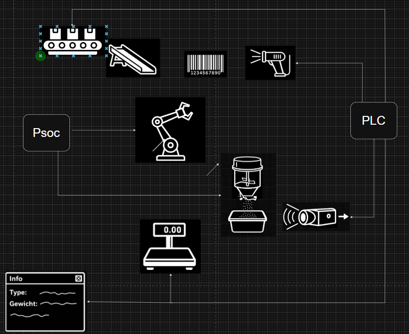
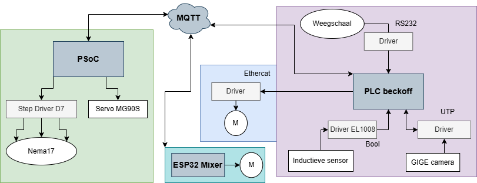

# 2EAI-PEN-2526-Industry4 (pannekoek)

Dit project ontwikkelt van een geautomatiseerd productiesysteem voor het scannen, mengen en verpakken van
ingrediënten met kwaliteitscontrole.

## Hardware

- Inductieve sensor (PLC)
- Servo-motoren voor Mixer & Robotarm
- NEMA17
    - [Stepmotor_lab jaar 1](docs/Stepmotor_lab.pdf)
- DC-Motor voor Mixer & PLC Transportband
- Weegschaal met RS232 connectie
- Batch-reader
- Robot-arm (IGUS SCARA-robot) via PSoC6
- Transportband via PLC
    - 3D print transportbandadapter
- 3D-printer
    - [Report turning servo adapter](docs/Report%20turning%20cilinder.pdf)
- pigtail connectors
  
zie ook: [Bomlijst](docs/Bomlijst.md)

## Software

- [Blender/Fusion => .stl => print](hardware/3Dprint/)
- Modustoolbox (MTB) => PSoC
- VSCode => ESP32
- Twincat3 => Beckoff PLC
- MQTT Mosquitto

## Programmeertalen

- C/C++ => MTB, VSCode
- Structure text => Twincat3

## Productieproces

1. Ingrediënt 1 Verwerking  
    Scannen en gieten van het eerste ingredient.
2. Ingrediënt 2 Verwerking  
    Scannen & gieten van het tweede ingrediënt.
3. Mengen  
    Automatisch mixen van de ingrediënten.
4. Vullen  
    Vullen van een bepaald volume van de mix.
5. Kwaliteitscontrole
    Controleren van de mix op ijzerverontreiniging.
6. Wegen  
    Afwegen van het eindproduct.
7. Registratie  
    Registreren van productiegegevens in het systeem.

## Resultaten

- [Taken Progressie](/docs/TASKS.md)
- [MQTT Demo & Documentatie](/docs/MOSQUITTO_SETUP.md)
    - geeft ook weer hoe verschillende delen van project wordt opgestart (software)

## Aan de slag

1. Connecteer I/O
2. Preparatie materiaal bakske vol met suiker,... op transportband
3. Volg [MQTT Demo & Documentatie](/docs/MOSQUITTO_SETUP.md)

## Toekomstig werk en problemen

- Mogelijke uitbreidingen of verbeteringen.
- Bekende bugs of beperkingen.
- Link eventueel naar een issue bv. #1

## Personen

- **Milan Posman** – _Student_ - MilanB
- **Bowen** – _Student_ - Bowen
- **Jonas Vanmarsenille** – JonasVanmarsenille
- **Victor** – _Student_ - Goose
- **Dieter Vanrykel** – _Docent_ – [GitHub](https://github.com/Vanrykel)
