# Installatie TC Vision op C6105 en Engineering PC

Deze handleiding beschrijft stap voor stap hoe TC Vision is geinstalleerd op een Beckhoff C6105 industrial pc met een Mako G-040C PoE camera.

## Overzicht

De installatie bestaat uit twee hoofdonderdelen:

**Deel 1: Runtime installatie op de C6105 (target)**
- IP-adres zoeken en Remote Desktop verbinding
- TwinCAT Package Manager en runtimes downloaden
- RT Ethernet activeren met TcRteinstall.exe
- PoE injector aansluiten en netwerkadapter configureren

**Deel 2: Engineering installatie op je laptop (engineering pc)**
- TwinCAT engineering packages downloaden
- Nieuw TwinCAT project aanmaken
- Route naar C6105 configureren
- TC Vision licentie activeren
- Vision Device en camera initialiseren
- Camera testen

Alle stappen zijn gedocumenteerd met screenshots uit de map `docs/images`.
In de screenshots geeft de rode box aan waar je op moet klikken of welke knop je moet selecteren.

## Benodigdheden

- Beckhoff C6105 (target/runtime)
- Engineering pc met TwinCAT XAE
- Netwerkverbinding tussen pc en C6105
- Toegang tot TwinCAT Package Manager
- Geldige TC Vision licentie

## Gebruikte opstelling

Deze installatie is uitgevoerd en getest met onderstaande opstelling:

- Beckhoff C6105 industriele pc (runtime/target)
- Laptop met TwinCAT (engineering)
- Camera: Mako G-040C PoE
- PoE injector: INJ POE-30W

## Deel 1: Runtime installatie op de C6105

### Stap 1: Vind het IP-adres van de C6105 en maak verbinding via Remote Desktop

Eerst heb ik het IP-adres van de C6105 opgezocht. Daarna heb ik via Remote Desktop verbinding gemaakt met de C6105 met gebruikersnaam Administratie en wachtwoord 1.

### Stap 2: Installeer TwinCAT Package Manager en runtimes

Download de TwinCAT Package Manager via de Beckhoff website. Daarna heb ik de migratie uitgevoerd en vervolgens de twee benodigde runtimes gedownload: de TwinCAT Vision runtime en de TwinCAT Standard 4026 runtime. Daarna installeer je deze runtimes in de Package Manager op de C6105.

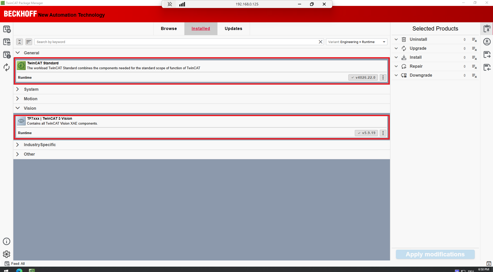
Deze foto laat zien dat TwinCAT Package Manager op de C6105 geopend is. De rode box wijst naar het onderdeel dat je moet downloaden om verder te gaan.

### Stap 3: Activeer RT Ethernet en sluit de PoE injector aan op de C6105

In deze stap activeer je RT Ethernet op de C6105. Je sluit eerst de PoE injector aan, daarna voer je TcRteinstall.exe uit.

**Stap 3a: Sluit de PoE injector aan op de C6105**

Sluit eerst de PoE injector (INJ POE-30W) als volgt aan:
- **Data in** van de PoE injector → ethernetpoort van de C6105 (je mag kiezen welke van de twee ethernetpoorten/RT-poorten)
- **Data & power out** van de PoE injector → Camera (Mako G-040C PoE)

**Stap 3b: Navigeer naar TcRteinstall.exe en voer het uit**

Open bestandsverkenner en navigeer naar `Beckhoff\TwinCAT\3.1\System`. Hier vind je het bestand **TcRteinstall.exe**. Dubbelklik erop om het uit te voeren.

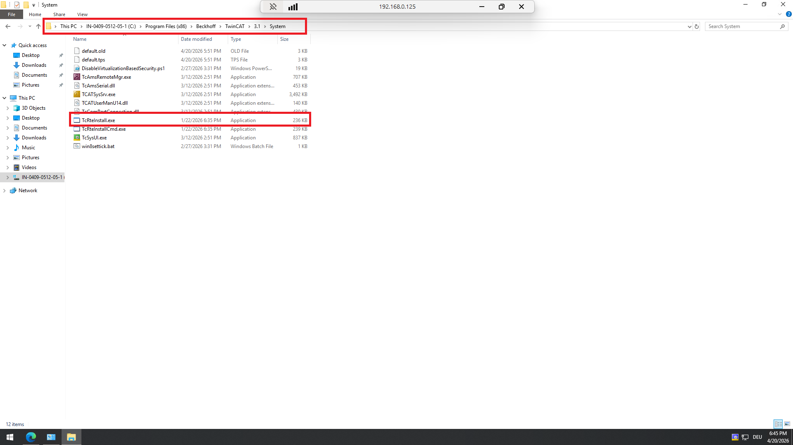
Deze foto laat zien waar het bestand TcRteinstall.exe staat op de C6105. De rode box markeert de map `Beckhoff\TwinCAT\3.1\System` waar je TcRteinstall.exe kunt vinden.

**Stap 3c: Selecteer de ethernetpoort en klik Install**

Na het uitvoeren van TcRteinstall.exe verschijnt een pop-up met de beschikbare ethernetpoorten van de C6105. Selecteer de poort waar je de PoE injector hebt aangesloten en klik op de **Install** button.

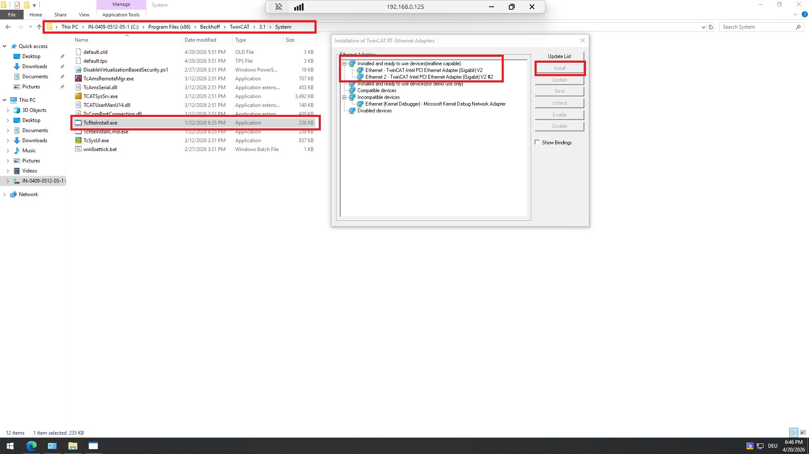
Deze foto toont de pop-up met de ethernetpoorten van de C6105. De rode box markeert de poort die je moet selecteren (dezelfde poort waar je de PoE injector hebt aangesloten). Klik op de **Install** button.

**Stap 3d: Stel het IP-adres in via Internet Protocol Version 4**

Na het installeren moet je ook de netwerkadapter configureren met een statisch IP-adres. Rechtsklik op de ethernetpoort waar de camera op is aangesloten, selecteer **Eigenschappen** en kies **Internet Protocol Version 4 (TCP/IPv4)**. Geef hier een statisch IP-adres naar eigen keuze in.

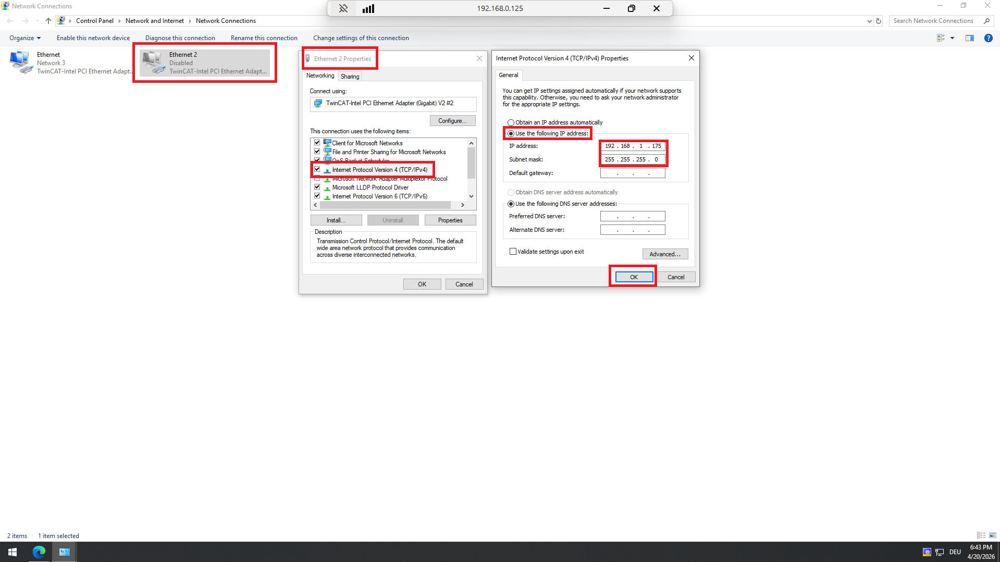
Deze foto toont hoe je de netwerkadapter configureert. De rode box markeert de plek waar je Internet Protocol Version 4 selecteert en het statische IP-adres instelt.

## Deel 2: Engineering installatie op je laptop

Nu zitten we in het gedeelte op je pc/laptop.

### Stap 1: Download engineering packages via TwinCAT Package Manager

Open op je laptop de TwinCAT Package Manager. In dit scherm download je de packages die je nodig hebt voor engineering:

- TwinCAT Standard Engineering
- TwinCAT 3 Vision Engineering

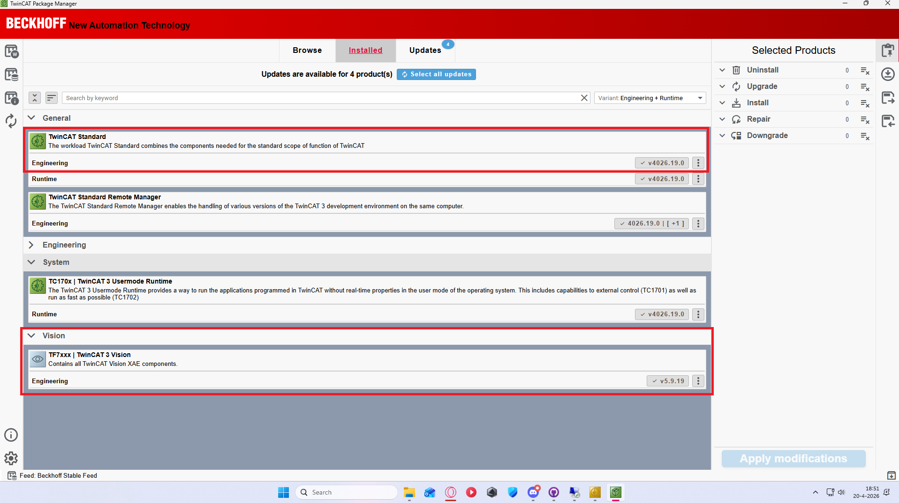
Deze foto toont de TwinCAT Package Manager op je laptop. De rode box markeert waar je de engineering packages moet selecteren en downloaden.

### Stap 2: Maak een nieuw TwinCAT project aan

Maak nu een nieuw project aan met een eigen projectnaam.

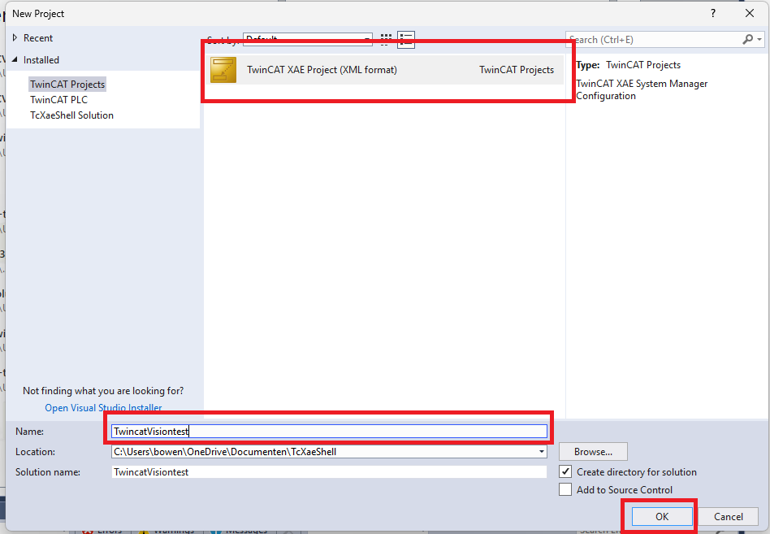
Deze foto toont waar je een nieuw TwinCAT project aanmaakt en de projectnaam invult.

### Stap 3: Controleer Build 4026 en zet op Config Mode

Controleer in TwinCAT dat je op Build 4026 zit en zet de runtime op Config Mode.

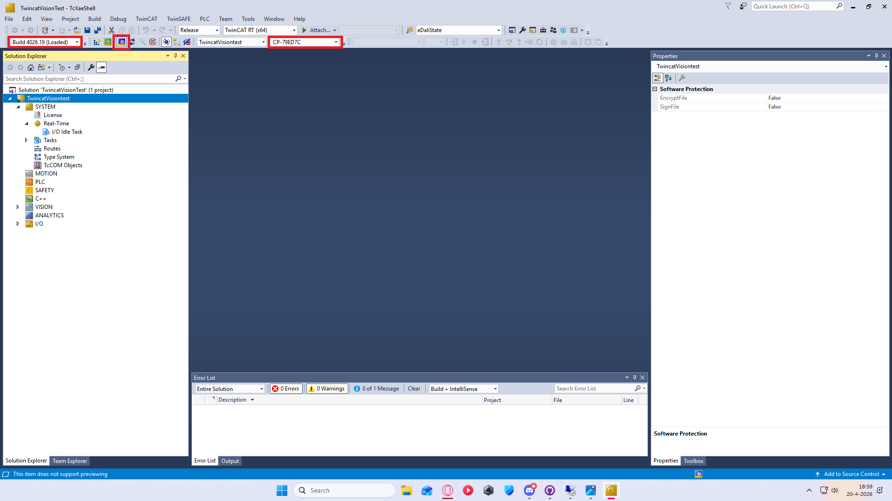
Deze foto laat zien dat je Build 4026 moet gebruiken en dat Config Mode actief moet zijn voordat je de route toevoegt.

### Stap 4: Voeg een route toe naar de C6105

Voeg nu een ADS-route toe naar de C6105 in plaats van Local.

1. Selecteer de C6105.
2. Klik op Add Route.
3. In de pop-up zet je Secure ADS uit.
4. Vul User: Administrator en Password: 1 in.
5. Klik op OK.

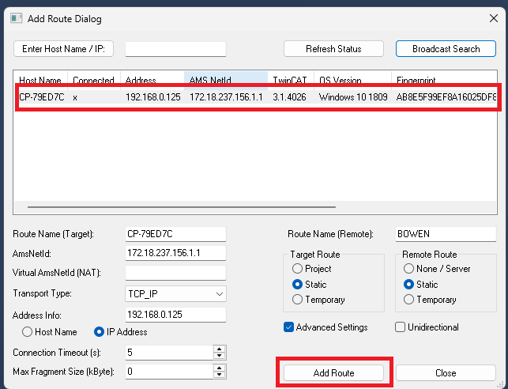
Deze foto toont dat je de C6105 moet selecteren en op Add Route moet klikken.

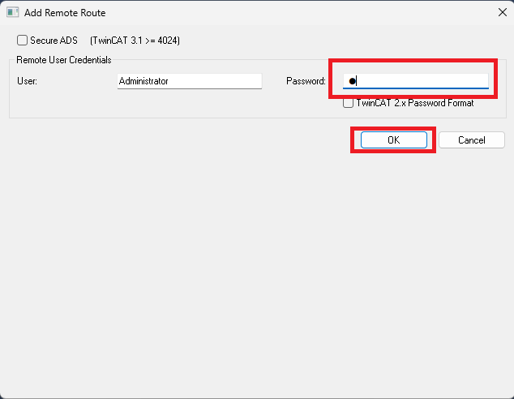
Deze foto toont de login pop-up waar je Secure ADS uitzet en inlogt met Administrator / 1.

### Stap 5: Voeg de TC Vision licentie toe

Ga in de Solution Explorer naar License en klik op Manage Licenses. Scroll naar beneden tot je TF7100 TC3 Vision Base ziet en zet deze op true.

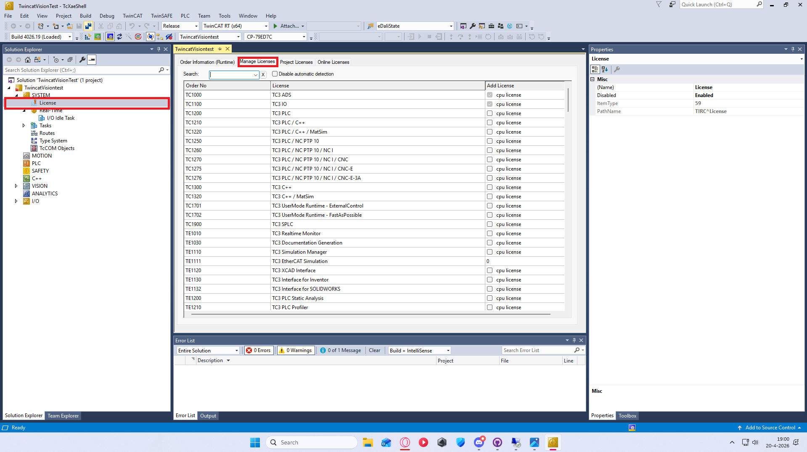
Deze foto toont het licentieoverzicht waar je op License en daarna op Manage Licenses klikt.

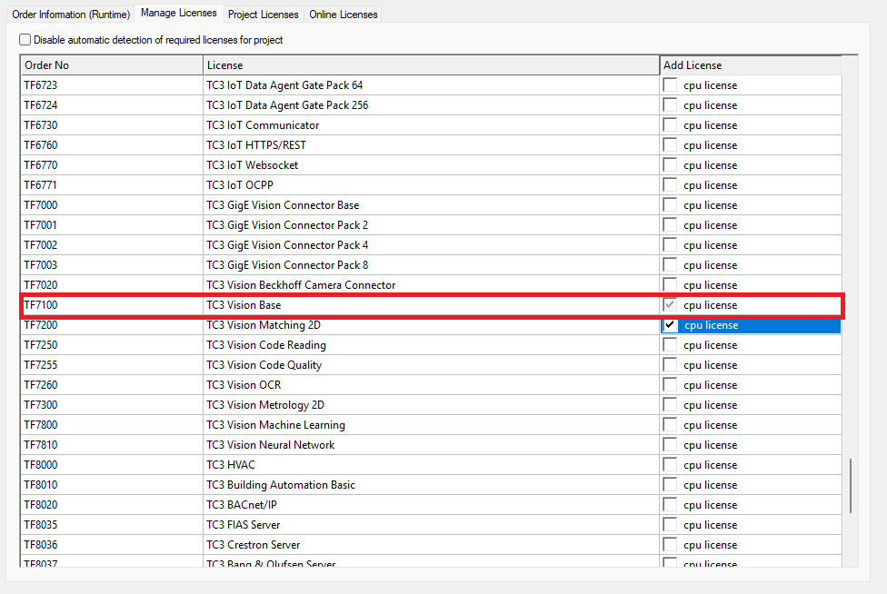
Deze foto laat zien waar je in de licentielijst TF7100 TC3 Vision Base moet zoeken en aanvinken op true.

### Stap 6: Voeg een Vision Device toe en selecteer netwerkdevice

Klik met de rechtermuisknop op het juiste onderdeel in de Solution Explorer en kies Add New Item.

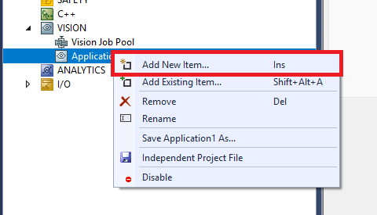
Deze foto toont waar je met de rechtermuisknop klikt en Add New Item selecteert.

Daarna krijg je een pop-up. Selecteer GigE Vision Camera en klik op OK.

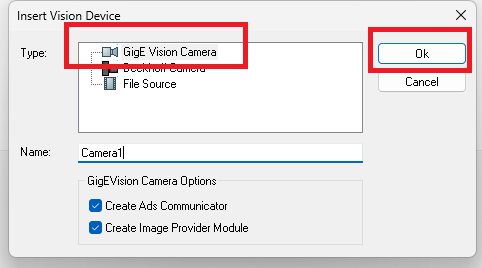
Deze foto toont de Insert Vision Device pop-up waar je GigE Vision Camera selecteert.

Vervolgens krijg je nog een pop-up Select Network Device:

1. Klik op New.
2. Klik daarna nog eens op New.
3. Selecteer daarna de device van de camera.
4. Selecteer vervolgens IP Stack.
5. Klik op OK.

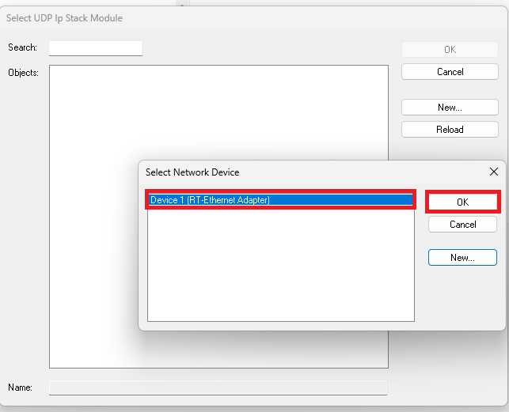
Deze foto toont de pop-up waarin je op New klikt en daarna de cameradevice kiest.

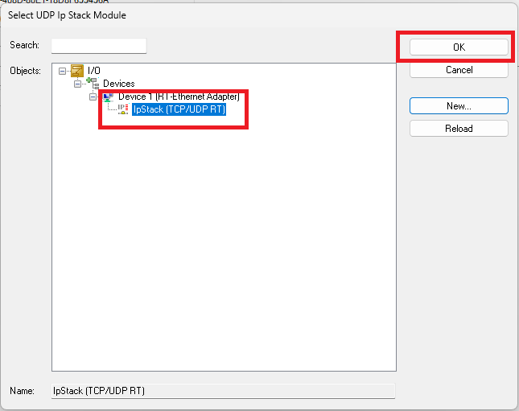
Deze foto toont dat je IP Stack selecteert en daarna op OK klikt.

### Stap 7: Ontdek en selecteer de camera

Nu krijg je het camera initialisatie-scherm. Klik op **Discover Devices** om beschikbare cameras te vinden.

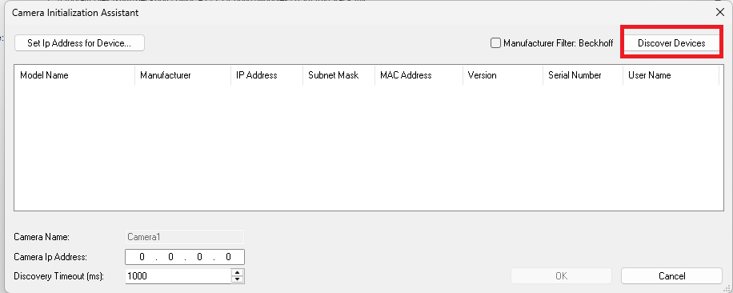
Deze foto toont het camera initialisatie-scherm waar je op Discover Devices klikt.

Daarna zie je een lijst met gevonden cameras. Selecteer jouw camera op basis van het statische IP-adres dat je eerder hebt ingesteld (Mako G-040C PoE).

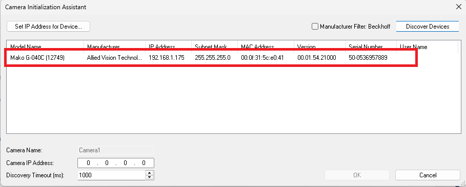
Deze foto toont de camera-selectie met de beschikbare cameras. Je selecteert je camera aan de hand van het IP-adres dat je hebt ingesteld.

### Stap 8: Controleer de verbinding en test de camera

Controleer dat de verbinding Online is. In het Status-veld zie je "Connection: Online". Dit betekent dat je camera actief is. Selecteer daarna **Configuration Assistant**.

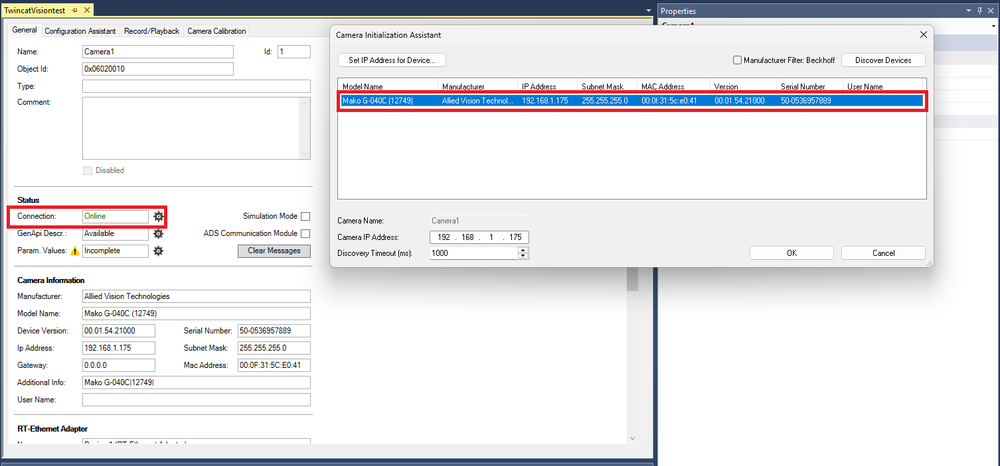
Deze foto toont het scherm waar je controlleert dat Status Connection op Online staat, wat betekent dat je camera actief is verbonden.

Nu klikt je op **Start Acquisition** om de camera in werking te stellen. Je ziet nu het live camerabeeld van je Mako G-040C PoE camera. Dit betekent dat alles goed werkt!

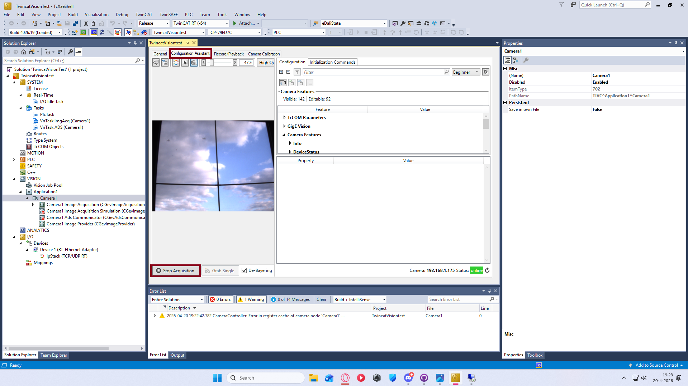
Deze foto toont het testscherm waar je op Start Acquisition klikt en het live camerabeeld verschijnt. Klaar!

## Samenvattingscontrolist na installatie

Controleer of de volgende punten correct zijn ingesteld:

**C6105 (target side):**
- ✓ Remote Desktop verbinding via Administratie / 1
- ✓ TwinCAT Package Manager geladen met de juiste versie
- ✓ TwinCAT Vision runtime en TwinCAT Standard 4026 runtime geïnstalleerd
- ✓ RT Ethernet geactiveerd via TcRteinstall.exe
- ✓ PoE injector aangesloten op de juiste ethernetpoort
- ✓ Netwerkadapter geconfigureerd met statisch IP-adres (IPv4)

**Laptop (engineering side):**
- ✓ TwinCAT Standard Engineering en TwinCAT 3 Vision Engineering gedownload
- ✓ Build 4026 actief en Config Mode ingeschakeld
- ✓ ADS-route naar C6105 toegevoegd met Administrator / 1 credentials
- ✓ Secure ADS uitgeschakeld in de route-configuratie
- ✓ TC Vision licentie (TF7100 TC3 Vision Base) op true gezet
- ✓ Vision Device (GigE Vision Camera) toegevoegd
- ✓ Netwerkadapter en IP Stack geselecteerd
- ✓ Camera ontdekt en geselecteerd op basis van statisch IP-adres
- ✓ Status Connection toont "Online"
- ✓ Live camerabeeld zichtbaar via Start Acquisition

## Veelvoorkomende problemen en oplossingen

### Geen verbinding met C6105
- Controleer of het IP-adres van de C6105 correct is
- Controleer de netwerkverbinding (check if both pc's are on the same network)
- Controleer de firewall-instellingen
- Controleer of Secure ADS correct is uitgeschakeld in de route
- Controleer credentials (Administrator / 1)

### Package Manager ontbreekt of is leeg
- Download de TwinCAT Package Manager opnieuw van de Beckhoff website
- Controleer of de juiste versie is gedownload (moet Build 4026 ondersteunen)
- Herstart de Package Manager

### TC Vision licentie niet actief
- Controleer of TF7100 TC3 Vision Base op true staat in Manage Licenses
- Controleer of de licentie-hardware-ID correct is gekoppeld
- Controleer of Config Mode is ingeschakeld

### Camera niet zichtbaar
- Controleer of de PoE injector correct is aangesloten (Data in → C6105, Data & power out → Camera)
- Controleer of het statische IP-adres op de C6105 netwerkadapter is ingesteld
- Controleer of RT Ethernet correct is geactiveerd via TcRteinstall.exe
- Voer Discovery opnieuw uit in de camera initialisatie
- Controleer of de camera wordt herkend met pingcommand (cmd: `ping <camera_ip>`)

### Ontdekken van devices geeft geen resultaten
- Controleer of IP Stack correct in de networkdevice-configuratie is geselecteerd
- Controleer of de netwerkadapter correct is ingesteld (rechtermuisknop → Eigenschappen → IPv4)
- Herstart TwinCAT en probeer opnieuw

## Referenties

- [Beckhoff TF7000-TF7810 TwinCAT 3 Vision officiële documentatie](https://infosys.beckhoff.com/english.php?content=../content/1033/tf7xxx_tc3_vision/6797108491.html)
- [C6105 Industrial PC informatie](https://www.beckhoff.com/)
- Mako G-040C PoE Camera documentation van Allied Vision
