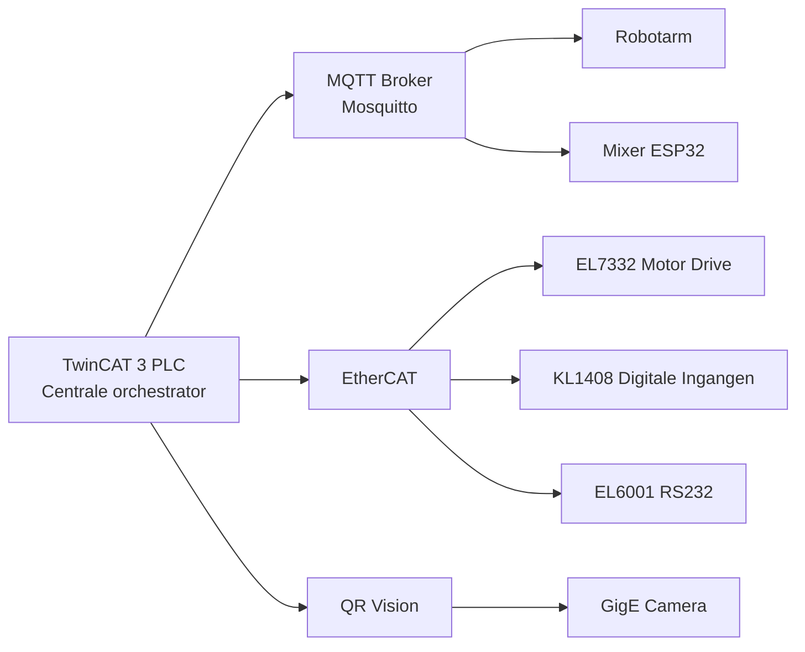
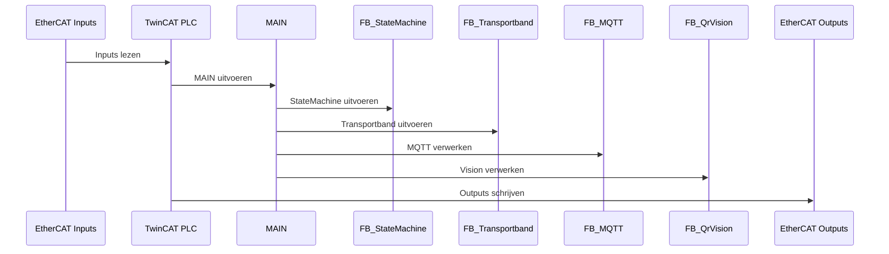
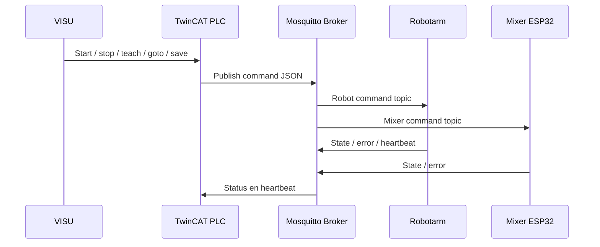
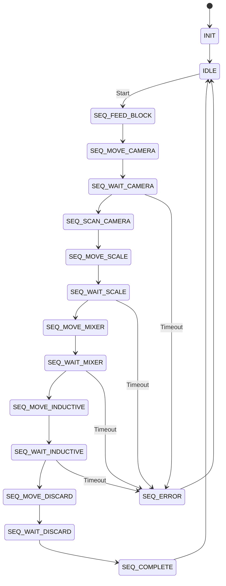

# TwinCAT 3 PLC Documentatie

## 1. Inleiding

### 1.1 Doel van het systeem
Dit document beschrijft het TwinCAT 3 besturingssysteem voor een geautomatiseerd pannenkoekenproces. De installatie combineert een transportband, robotarm, MQTT-communicatie, QR Vision en EtherCAT-I/O in een centrale PLC-architectuur. De PLC fungeert als orchestrator: zij bewaakt de procesvolgorde, publiceert commando's, verwerkt statusinformatie en coördineert de subsystemen in een deterministische cyclus.

De belangrijkste functies van het systeem zijn:
- pannenkoeken transporteren via een tijdgestuurde transportband;
- robotarmcommando's publiceren en robotstatus ontvangen via MQTT;
- QR-codes lezen via TwinCAT Vision en de batchinformatie verwerken;
- fysiek I/O beheren via EtherCAT met EL7332, KL1408 en EL6001;
- procesveiligheid en foutafhandeling centraal bewaken.

### 1.2 Scope
Binnen deze documentatie vallen:
- TwinCAT 3 PLC-logica en functionele modules;
- EtherCAT-configuratie en motion control voor de transportband;
- MQTT-topicstructuur, payloads en communicatiestromen;
- TwinCAT Vision integratie voor QR-detectie;
- configuratieparameters in GVL's;
- integratietesten, troubleshooting en onderhoud.

Buiten scope vallen:
- de mechanische detailconstructie van de volledige machine;
- firmware van externe subsystemen tot op broncode-niveau;
- de hardwareconfiguratie in de TwinCAT-projectfile zelf, behalve waar deze functioneel relevant is.

## 2. Systeemarchitectuur

### 2.1 Overzicht



De architectuur is modulair opgezet. De PLC bestuurt de sequentie, maar externe subsystemen voeren de fysieke acties uit. MQTT koppelt de PLC aan de robotarm en mixer. EtherCAT koppelt de PLC aan motor, digitale ingangen en weegschaal. Vision levert batchherkenning via QR-codes.

### 2.2 Hardware Architectuur

| Component | Functie | Technische beschrijving |
|---|---|---|
| TwinCAT 3 Runtime | Centrale besturing | Draait op Windows en voert de PLC-cyclus deterministisch uit. |
| EL7332 | Motorbesturing transportband | Beckhoff EtherCAT DC-motorterminal met velocity mode en NC-axisconfiguratie. |
| KL1408 | Digitale ingangen | 8-kanaals digitale inputterminal voor inductieve sensor en noodstop. |
| EL6001 | RS232 communicatie | Seriele koppeling met de weegschaal op 9600 baud. |
| Robotarm | Extern manipulatiesysteem | Ontvangt commando's via MQTT en publiceert status, fout en heartbeat. |
| ESP32 Mixer | Mixerbesturing | Ontvangt MQTT-commando's voor het mengproces en publiceert status. |
| GigE Camera | QR-beeldacquisitie | Industriële camera voor TwinCAT Vision en batchidentificatie. |
| Mosquitto Broker | Communicatielaag | MQTT-broker op 192.168.1.240:1883. |

De EtherCAT-configuratie staat in de TwinCAT-projectconfiguratie (.tsproj) en niet in de PLC sourcebestanden. De PLC-code gebruikt alleen de gemapte variabelen en statusbits.

### 2.3 Software Architectuur

#### MAIN
Verantwoordelijkheden:
- VISU-interactie en knopverwerking;
- commandoverwerking met flankdetectie;
- integratie van alle functionele modules;
- globale statusopbouw voor HMI en diagnosestatus.

#### FB_StateMachine
Verantwoordelijkheden:
- procesorkestratie van de automatische cyclus;
- timeoutbeheer per robotstap;
- sensorlogica en stateovergangen;
- foutafhandeling en gecontroleerde terugkeer naar IDLE.

#### FB_Transportband
Verantwoordelijkheden:
- motorbesturing van de transportband;
- timing via TON-timer;
- start/stop met flankdetectie;
- deterministische cyclusafronding.

#### FB_MQTT
Verantwoordelijkheden:
- MQTT clientconnectie;
- publish/subscribe voor robot, mixer en transportband;
- heartbeat watchdog;
- parsing van JSON payloads en statusflags.

#### FB_QrVision
Verantwoordelijkheden:
- camera-initialisatie en beeldacquisitie;
- QR-detectie met meerdere decodepogingen;
- overlay en visuele diagnostiek;
- camerastatus en HRESULT-bewaking.

| Module | Rol | Kernfunctie |
|---|---|---|
| MAIN | Centrale regie | Verwerkt VISU-inputs en verdeelt commando's. |
| FB_StateMachine | Proceslogica | Stuurt de volledige sequentie en uitzonderingen. |
| FB_Transportband | Motion timing | Bepaalt transportduur en stopgedrag. |
| FB_MQTT | Communicatie | Verzorgt berichtenverkeer en watchdog. |
| FB_QrVision | Vision | Leest QR-codes en levert status aan de PLC. |

## 3. PLC Uitvoermodel

De PLC-cyclus wordt telkens in vaste volgorde uitgevoerd:

1. Inputs lezen
2. MAIN uitvoeren
3. StateMachine uitvoeren
4. Transportband uitvoeren
5. MQTT verwerken
6. Vision verwerken
7. Outputs schrijven



De PLC-cyclus is ontworpen om deterministisch te blijven. De meeste commando's worden op basis van rising edges getriggerd zodat korte VISU-pulsen niet verloren gaan. Tijdkritische onderdelen zoals robottimeouts, QR-scans en transportbandloops worden met timers bewaakt.

## 4. EtherCAT Configuratie

### 4.1 EL7332

De EL7332 stuurt de transportband aan via velocity mode. De terminal wordt als NC-axis gebruikt voor snelheidsgestuurde motorbesturing.

| PLC-variabele | Terminal | Functie |
|---|---|---|
| `nMotorOutput` | EL7332 kanaal 1 | Snelheidssetpoint 0-32767 voor 0-10V. |
| `bTransportbandRunning` | EL7332 kanaal 1 | Aanduiding dat de band draait. |
| `bTransportbandDone` | EL7332 kanaal 1 | Aanduiding dat de bandcyclus voltooid is. |

### 4.2 KL1408

De KL1408 levert digitale ingangen voor inductieve detectie en noodstoplogica.

| PLC-variabele | Kanaal | Functie |
|---|---|---|
| `bInductiveSensor` | Kanaal 1 | Detectie van metaal of productaanwezigheid. |
| `bEmergencyStop` | Kanaal 2 | Noodstopinput. |

### 4.3 EL6001

De EL6001 verzorgt RS232-communicatie met de weegschaal.

| PLC-variabele | Interface | Functie |
|---|---|---|
| `bWeigthScaleReady` | EL6001 RS232 | Status dat de weegschaal gereed is. |
| `sWeigthScale_Input` | EL6001 RS232 | Seriële data van de weegschaal. |

De EtherCAT-klemconfiguratie staat in de .tsproj en is daarom niet als PLC-broncode zichtbaar. De PLC gebruikt alleen de gemapte processen en statusvariabelen.

## 5. MQTT Integratie

### 5.1 Broker Configuratie

| Parameter | Waarde | Functie |
|---|---|---|
| Broker IP | 192.168.1.240 | MQTT-brokeradres. |
| Poort | 1883 | Standaard MQTT-poort. |
| Broker software | Mosquitto | MQTT-message broker. |
| Type verbinding | TCP | Pub/sub-communicatie. |

### 5.2 Topics

| Topic | Richting | QoS | Functie |
|---|---|---:|---|
| `pancake/robot/cmd` | PLC -> Robotarm | 1 | Commandos zoals teach, goto, save en stop. |
| `pancake/robot/state` | Robotarm -> PLC | 0 | Status van de robotarm. |
| `pancake/robot/error` | Robotarm -> PLC | 0 | Robotfout of alarm. |
| `pancake/robot/heartbeat` | Robotarm -> PLC | 0 | Levenssignaal voor watchdog. |
| `pancake/mixer/cmd` | PLC -> Mixer | 1 | Start- en stopcommando's voor de mixer. |
| `pancake/mixer/state` | Mixer -> PLC | 0 | Operationele status van de mixer. |
| `pancake/mixer/status` | Mixer -> PLC | 0 | Extra operationele status. |
| `pancake/mixer/error` | Mixer -> PLC | 0 | Mixerfouten. |
| `pancake/transportband/state` | PLC -> HMI/diagnose | 0 | Status van de transportband. |

### 5.3 Payloads

#### Robot command payloads
```json
{ "cmd": "teach", "pose": "camera" }
{ "cmd": "goto", "pose": "scale" }
{ "cmd": "save" }
{ "cmd": "stop" }
```

#### Robot status payloads
```json
{ "state": "idle" }
{ "state": "running" }
{ "state": "done" }
{ "state": "at_camera" }
{ "state": "teach_camera" }
```

#### Robot error payloads
```json
{ "state": "ok", "error": false, "message": "" }
{ "state": "error", "error": true, "message": "unknown command" }
```

#### Mixer payloads
```json
{ "cmd": "start" }
{ "state": "mixing" }
{ "state": "done" }
{ "state": "error", "message": "motor overload" }
```

#### Heartbeat payloads
```json
{ "heartbeat": true, "timestamp": "2026-06-02T12:00:00Z" }
```

### 5.4 Communicatieflow



## 6. Functionele Modules

### 6.1 MAIN

#### Doel
MAIN is het centrale orchestratiepunt van de PLC. De functie moduleert alle VISU-aanvragen, genereert pulscommando's en verbindt de modules met elkaar.

#### Variabelentabel

| Variabele | Type | Functie |
|---|---|---|
| `fbStateMachine` | FB_StateMachine | Instantie voor proceslogica. |
| `fbTransportband` | FB_Transportband | Instantie voor transportbandregeling. |
| `fbMqtt` | FB_MQTT | Instantie voor MQTT-communicatie. |
| `fbQrVision` | FB_QrVision | Instantie voor QR Vision. |
| `rVisuStartTap` | R_TRIG | Rising edge voor start. |
| `rVisuStopTap` | R_TRIG | Rising edge voor stop. |
| `rRobotTeachTap` | R_TRIG | Rising edge voor teach. |
| `rRobotGotoTap` | R_TRIG | Rising edge voor goto. |
| `rRobotSaveTap` | R_TRIG | Rising edge voor save. |
| `rRobotStopTap` | R_TRIG | Rising edge voor robotstop. |
| `bStartCmd` | BOOL | Puls naar state machine. |
| `bStopCmd` | BOOL | Puls naar state machine. |
| `bRobotTeachCmd` | BOOL | Puls naar MQTT voor teach. |
| `bRobotGotoCmd` | BOOL | Puls naar MQTT voor goto. |
| `bRobotSaveCmd` | BOOL | Puls naar MQTT voor save. |
| `bRobotStopCmd` | BOOL | Puls naar MQTT voor stop. |

#### Werking
MAIN leest de VISU-inputs, detecteert stijgende flanken en genereert vervolgens eenduidige commando's. De module bepaalt ook of handmatige robotcommando's toegestaan zijn wanneer de automatische sequentie is uitgeschakeld. Daarna koppelt MAIN de outputs van de state machine, transportband, MQTT en Vision aan de globale statusvariabelen.

#### Veiligheid
- R_TRIG voorkomt herhalende commando's.
- Stop heeft prioriteit boven overige commando's.
- Automatische en handmatige bediening zijn logisch gescheiden.
- VISU-flags worden na verwerking gewist zodat een commando exact eenmaal wordt uitgevoerd.

#### Foutafhandeling
- Geen startpuls: geen sequentie.
- Vastzittende knop: geen herhaalcommando door flankdetectie.
- Systeemfout: status wordt doorgestuurd naar de state machine.
- Robotoffline: displaytekst en status worden geactualiseerd via MQTT.

### 6.2 FB_StateMachine

#### Doel
FB_StateMachine implementeert de volledige geautomatiseerde procesflow van het pannenkoekenproces. De module beheert de volgorde van transportband, robotposities, QR-scan en sensorlogica.

#### Variabelentabel

| Variabele | Type | Functie |
|---|---|---|
| `bAutoEnable` | BOOL | Automatische cyclus toegestaan. |
| `bStartRequest` | BOOL | Start van de sequentie. |
| `bStopRequest` | BOOL | Stop of reset. |
| `bError` | BOOL | Systeemfout. |
| `bTransportbandDone` | BOOL | Transportbandcyclus voltooid. |
| `bRobotBusy` | BOOL | Robot in beweging. |
| `bRobotDone` | BOOL | Robot op bestemming. |
| `bQrCodeFound` | BOOL | QR-code gevonden. |
| `bInductiveSensor` | BOOL | Inductieve sensor actief. |
| `tRobotTimeout` | TIME | Timeout per robotstap. |
| `tQrScanDuration` | TIME | QR-scanvenster. |
| `tSensorWaitDuration` | TIME | Wachttijd sensorlogica. |
| `sPoseCamera` | STRING | Pose camera. |
| `sPoseScale` | STRING | Pose scale. |
| `sPoseMixer` | STRING | Pose mixer. |
| `sPoseInductive` | STRING | Pose inductive. |
| `sPoseDiscard` | STRING | Pose discard. |
| `eStateOut` | E_MainState | Externe state voor display. |
| `bStartCmd` | BOOL | Transportband starten. |
| `bStopCmd` | BOOL | Transportband stoppen. |
| `bRobotGotoCmd` | BOOL | Robot naar een pose sturen. |
| `bRobotStopCmd` | BOOL | Robot noodstop. |
| `bQrAutoEnable` | BOOL | QR-venster activeren. |
| `sRobotTargetPose` | STRING | Huidige robotdoelpositie. |
| `eState` | E_MainState | Interne state. |
| `bRobotBusySeen` | BOOL | Busy-handshake gezien. |

#### Werking
De state machine start in INIT, gaat naar IDLE en wacht op een startverzoek. Na start wordt eerst de transportband geactiveerd, gevolgd door de camera-, scale-, mixer-, inductieve sensor- en discardstappen. Elke stap gebruikt een timeout en een duidelijk gedefinieerde overgang. QR-scannen is beperkt tot een scanvenster. De robot moet busy en done correct teruggeven voordat een stap als voltooid wordt beschouwd.

#### State Diagram



#### Veiligheid
- Per robotstap geldt een timeout van 12 seconden.
- Busy-done-handshake voorkomt foutieve statusinterpretatie.
- QR- en sensortijdvensters begrenzen de wachttijd.
- Stopverzoek heeft onmiddellijke prioriteit.
- Fouten leiden naar SEQ_ERROR en daarna gecontroleerd terug naar IDLE.

#### Foutafhandeling
- Robottimeout: overgang naar SEQ_ERROR.
- QR niet gevonden: sequentie gaat gecontroleerd door.
- Sensor timeout: sequentie gaat gecontroleerd door.
- Stoprequest: directe afbreking van de cyclus.
- Systeemfout: state machine bewaakt herstel via reset naar IDLE.

### 6.3 FB_Transportband

#### Doel
FB_Transportband bestuurt de transportband met een eenvoudige, robuuste en deterministische cyclus. Een startpuls activeert de band, waarna een timer de looptijd begrenst.

#### Variabelentabel

| Variabele | Type | Functie |
|---|---|---|
| `bStart` | BOOL | Startcommando, flankgestuurd. |
| `bStop` | BOOL | Stopcommando of noodstop. |
| `tDuration` | TIME | Looptijd van de motor. |
| `bRunning` | BOOL | Motor actief. |
| `bDone` | BOOL | Cyclus voltooid. |
| `nMotorControl` | INT | Analoge uitgang voor EL7332. |
| `tRun` | TON | Timer voor runfase. |
| `rStartTrig` | R_TRIG | Rising edge detector. |
| `bCycleActive` | BOOL | Latch voor actieve cyclus. |

#### Werking
Een startpuls zet de motor aan en start de timer. Tijdens de actieve cyclus blijft de output hoog. Zodra de timer afloopt, wordt de motor uitgeschakeld en wordt de done-flag gezet. Een stopcommando reset alles onmiddellijk.

#### Veiligheid
- Noodstop heeft prioriteit.
- Start gebeurt alleen op rising edge.
- Een latch voorkomt dubbel starten.
- De motoroutput wordt meteen naar nul gezet bij stop.

#### Foutafhandeling
- Vastzittende startinput: geen dubbel uitvoeren.
- Timerproblemen: runtime bewaakt timerwerking.
- Ontbrekend stopcommando: timer beperkt de run automatisch.
- Geen motorfeedback: alleen de opdrachtstatus is zichtbaar.

### 6.4 FB_MQTT

#### Doel
FB_MQTT verzorgt de volledige MQTT-clientlogica voor robot, mixer en transportband. De module publiceert commando's, verwerkt statusberichten en bewaakt robot-heartbeats.

#### Variabelentabel

| Variabele | Type | Functie |
|---|---|---|
| `bTransportbandRunning` | BOOL | Transportband actief. |
| `bTransportbandDone` | BOOL | Transportband voltooid. |
| `bRobotTeachCmd` | BOOL | Teach commando. |
| `bRobotGotoCmd` | BOOL | Goto commando. |
| `bRobotSaveCmd` | BOOL | Save commando. |
| `bRobotStopCmd` | BOOL | Stop commando. |
| `sRobotTargetPose` | STRING | Doelpose voor robot. |
| `bSystemError` | BOOL | Systeemfout. |
| `sErrorMessage` | STRING | Fouttekst. |
| `bRemoteStart` | BOOL | Remote startverzoek. |
| `bRemoteStop` | BOOL | Remote stopverzoek. |
| `bRemoteRobotTeach` | BOOL | Remote teachverzoek. |
| `bRemoteRobotGoto` | BOOL | Remote gotoverzoek. |
| `bRemoteRobotSave` | BOOL | Remote saveverzoek. |
| `bRemoteRobotStop` | BOOL | Remote stopverzoek. |
| `bRobotArmRunning` | BOOL | Robot draait. |
| `bRobotArmDone` | BOOL | Robot klaar. |
| `bRobotArmOnline` | BOOL | Robot online via heartbeat. |
| `bRobotArmBusy` | BOOL | Robot busy. |
| `bRobotArmTeachMode` | BOOL | Robot teach-modus. |
| `bRobotArmAlarm` | BOOL | Robot alarm. |
| `bRobotArmAckOk` | BOOL | Command acknowledgement ontvangen. |
| `fbMqttClient` | FB_IotMqttClient | MQTT-clientinstantie. |
| `fbMessageQueue` | FB_IotMqttMessageQueue | Message queue. |
| `fbMessage` | FB_IotMqttMessage | Enkele MQTT message. |
| `bMqttConfigured` | BOOL | Eenmalige configuratie. |
| `bSubscribedXxx` | BOOL | Topic-subscriptiestatus. |
| `sPayloadRcv` | STRING | Ontvangen payloadbuffer. |
| `sPayloadPub` | STRING | Te publiceren payloadbuffer. |
| `fbRobotHeartbeatWatchdog` | TON | Heartbeat watchdog. |
| `bRobotHeartbeatPulse` | BOOL | Heartbeat ontvangen in cyclus. |
| `bRobotStateReceived` | BOOL | Statebericht ontvangen. |
| `bRobotErrorActive` | BOOL | Actieve foutstatus. |

#### Werking
De client wordt eenmalig geconfigureerd met broker, poort en ID. Daarna verbindt de client, abonneert zich op de relevante topics en publiceert JSON commando's met QoS 1. Robotstatus, foutstatus en heartbeat worden verwerkt en omgezet naar PLC-statusvariabelen. De heartbeat watchdog schakelt de robot offline wanneer gedurende 12 seconden geen heartbeat binnenkomt.

#### Veiligheid
- QoS 1 wordt gebruikt voor commando's.
- QoS 0 wordt gebruikt voor statusberichten.
- Heartbeat watchdog bewaakt online-aanwezigheid.
- Topic-subscripties worden opnieuw ingesteld bij reconnect.
- JSON parsing gebeurt defensief; ongeldige payloads worden overgeslagen.

#### Foutafhandeling
- Broker down: reconnect en subscriptieherstel.
- Geen heartbeat: robot wordt offline gezet.
- Ongeldige payload: vorige status blijft behouden.
- Volle queue: berichten worden sequentieel afgehandeld.
- Geen acknowledgement: watchdog en statuslogica vangen de situatie op.

### 6.5 FB_QrVision

#### Doel
FB_QrVision implementeert QR-codeherkenning met TwinCAT Vision. De module beheert cameraopstart, beeldacquisitie, decodering, overlay en foutdiagnose.

#### Variabelentabel

| Variabele | Type | Functie |
|---|---|---|
| `bEnable` | BOOL | Visionverwerking activeren. |
| `bCodeFound` | BOOL | QR-code gevonden. |
| `sCodeAsString` | STRING | Gedecodeerde QR-tekst. |
| `sDisplayText` | STRING | Weergavetekst voor HMI. |
| `hrLast` | HRESULT | Laatste HRESULT voor diagnose. |
| `bCameraConnected` | BOOL | Camera is actief verbonden. |
| `fbCameraControl` | FB_VN_GevCameraControl | Camera-interface. |
| `eState` | ETcVnCameraState | Camerastatus. |
| `hr` | HRESULT | Werkend HRESULT. |
| `ipImageIn` | ITcVnImage | Invoerbeeld. |
| `ipImageInDisp` | ITcVnDisplayableImage | Displaybare invoer. |
| `ipImageRGB` | ITcVnImage | RGB-conversie. |
| `ipImageResDisp` | ITcVnDisplayableImage | Resultaatbeeld. |
| `ipCodeDecodedList` | ITcVnContainer | Gedecodeerde QR-data. |
| `ipCodeContourList` | ITcVnContainer | Contouren voor overlay. |
| `hrQr` | HRESULT | Resultaat van QR-operatie. |
| `nQrAttempt` | USINT | Decodepoging 1..3. |
| `aColorRed` | TcVnVector4_LREAL | Rode overlaykleur. |

#### Werking
De camera wordt gestart zodra de module enabled is. Tijdens acquisitie wordt elk beeld opgehaald en drie decodepogingen worden geprobeerd met verschillende oriëntaties of strategieën. Als een QR-code wordt gevonden, wordt de string opgeslagen en wordt een overlay gemaakt. Als geen code wordt gevonden, blijft de module actief en wordt een duidelijke displaytekst getoond.

#### Veiligheid
- Camera reset bij foutstatus.
- Enable schakelt de volledige pipeline.
- Meerdere decodepogingen verhogen de robuustheid.
- Niet gevonden QR blokkeert de procesflow niet.
- HRESULT-tracking maakt diagnose mogelijk.

#### Foutafhandeling
- Camera offline: status en displaytekst worden aangepast.
- Beeldophaal-fout: opnieuw proberen bij volgende cyclus.
- QR-decode mislukt: display toont geen code.
- Lege QR-string: lege string wordt gerapporteerd.
- Vision-libraryfout: HRESULT beschikbaar voor diagnose.

## 7. Veiligheidsconcept

### 7.1 Softwareveiligheid
- **Heartbeat watchdog**: robot wordt offline na 12 seconden zonder heartbeat.
- **Robot timeout**: elke robotstap heeft een maximum wachttijd.
- **QR timeout**: QR-scan is begrensd in tijd.
- **Sensor timeout**: inductieve detectie wordt niet onbeperkt afgewacht.

### 7.2 Hardwareveiligheid
- **Emergency stop**: noodstopinput op de KL1408 onderbreekt de cyclus.
- **EtherCAT watchdog**: communicatieverlies tussen master en terminal wordt als fout beschouwd.
- **EL7332 overload protection**: motorstroom en nominale spanning worden bewaakt.

### 7.3 Communicatieveiligheid
- **MQTT reconnect**: de client herstelt verbinding met de broker.
- **QoS 1 command delivery**: commando's worden betrouwbaar afgeleverd.
- **Topic-isolatie**: commando's en status blijven logisch gescheiden.

## 8. Configuratieparameters

### 8.1 GVL_Config

| Variabele | Type | Default | Functie |
|---|---|---|---|
| `bAutoSequenceEnable` | BOOL | TRUE | Automatische sequentie aan of uit. |
| `tRobotTimeout` | TIME | T#12S | Timeout per robotstap. |
| `tQrScanDuration` | TIME | T#2S | QR-scanvenster. |
| `tSensorWaitDuration` | TIME | T#3S | Wachttijd sensorlogica. |
| `tFeedDuration` | TIME | T#3S | Looptijd transportband. |
| `sPoseCamera` | STRING | camera | Robotpose camera. |
| `sPoseScale` | STRING | scale | Robotpose scale. |
| `sPoseMixer` | STRING | mixer | Robotpose mixer. |
| `sPoseInductive` | STRING | inductive | Robotpose inductive. |
| `sPoseDiscard` | STRING | discard | Robotpose discard. |

### 8.2 GVL_MQTT

| Variabele | Type | Functie |
|---|---|---|
| `sMqttBroker` | STRING | Brokeradres. |
| `nMqttPort` | INT | Brokerpoort. |
| `bEnableMqtt` | BOOL | MQTT in- of uitschakelen. |
| `bVisuStartTransportband` | BOOL | Start transportband via VISU. |
| `bVisuStopTransportband` | BOOL | Stop transportband via VISU. |
| `bVisuStartSequence` | BOOL | Start automatische sequentie. |
| `bVisuAutoSequenceEnable` | BOOL | Automatisering aan/uit. |
| `bVisuRobotTeach` | BOOL | Robot teach via VISU. |
| `bVisuRobotGoto` | BOOL | Robot goto via VISU. |
| `bVisuRobotSave` | BOOL | Robot save via VISU. |
| `bVisuRobotStop` | BOOL | Robot stop via VISU. |
| `bRobotArmOnline` | BOOL | Robot online. |
| `bRobotArmBusy` | BOOL | Robot busy. |
| `bRobotArmDone` | BOOL | Robot done. |
| `bRobotArmTeachMode` | BOOL | Robot teach-modus. |
| `bRobotArmAlarm` | BOOL | Robot alarm. |
| `sRobotArmDisplay` | STRING | Leesbare robotstatus. |
| `bTransportbandRunning` | BOOL | Transportband actief. |
| `bTransportbandDone` | BOOL | Transportband klaar. |
| `sTransportbandDisplay` | STRING | Leesbare transportbandstatus. |
| `sCurrentState` | STRING | Huidige state machine state. |
| `bSystemError` | BOOL | Systeemfout. |
| `sErrorMessage` | STRING | Foutmelding. |
| `sTopicRobotCmd` | STRING | Robot command topic. |
| `sTopicRobotState` | STRING | Robot state topic. |
| `sTopicRobotError` | STRING | Robot error topic. |
| `sTopicRobotHeartbeat` | STRING | Robot heartbeat topic. |
| `sTopicTransportbandCmd` | STRING | Transportband command topic. |
| `sTopicTransportbandState` | STRING | Transportband state topic. |
| `sTopicMixerCmd` | STRING | Mixer command topic. |
| `sTopicMixerState` | STRING | Mixer state topic. |

### 8.3 GVL_Data

| Variabele | Type | Functie |
|---|---|---|
| `bQrCodeFound` | BOOL | QR-code gedetecteerd. |
| `sQrCodeText` | STRING | Ruwe QR-codeinhoud. |
| `sQrDisplayText` | STRING | Displaytekst voor HMI. |
| `fWeight` | REAL | Gewicht van de pannenkoek. |
| `bInductiveSensorDetected` | BOOL | Detectie van product op sensor. |
| `dBatchStartTime` | DT | Batchstarttijd. |
| `dBatchEndTime` | DT | Batcheindtijd. |
| `uBatchNumber` | UDINT | Batchnummer. |

### 8.4 GVL_Inputs

| Variabele | Type | Bron | Functie |
|---|---|---|---|
| `bInductiveSensor` | BOOL | KL1408 kanaal 1 | Metaaldetectie of productdetectie. |
| `bWeigthScaleReady` | BOOL | EL6001 RS232 | Weegschaal gereed. |

### 8.5 GVL_Outputs

| Variabele | Type | Doel | Functie |
|---|---|---|---|
| `nMotorOutput` | INT | EL7332 kanaal 1 | Snelheidssetpoint 0-32767 = 0-10V. |
| `nAlarmLamp` | BOOL | Alarmlamp | Visuele foutindicatie. |

## 9. Timing Analyse

| Processtap | Tijd | Opmerking |
|---|---:|---|
| Transportband starten en lopen | 3 s | Timergestuurde run. |
| Robot naar camera | 4 s | Gemiddelde verplaatsing. |
| QR-scan | 2 s | Vast scanvenster. |
| Robot naar scale | 4 s | Verplaatsing naar weegschaal. |
| Robot naar mixer | 4 s | Verplaatsing naar mixer. |
| Robot naar inductieve sensor | 4 s | Verplaatsing naar detectiepositie. |
| Robot naar discard | 4 s | Eindpositie. |
| Communicatie- en veiligheidsmarges | 15-25 s | MQTT, bevestigingen en wachttijden. |

- **Minimale cyclustijd**: ongeveer 30 seconden, wanneer reacties zeer snel zijn en marges beperkt blijven.
- **Nominale cyclustijd**: ongeveer 40 tot 50 seconden.
- **Maximale cyclustijd**: ongeveer 60 seconden, wanneer robotbewegingen of netwerkreacties trager verlopen.

Invloed van subsystemen:
- MQTT beïnvloedt de tijd door publicatie, ontvangst en heartbeat-interval.
- Robotbewegingen zijn de grootste tijdscomponent in de sequentie.
- Vision voegt een vaste scanperiode toe, maar blokkeert de cyclus niet bij een ontbrekende QR-code.

## 10. EL7332 Motion Control Configuratie

### CoE 8020

| Index | Parameter | Waarde | Eenheid | Opmerking |
|---|---|---:|---|---|
| 8020:01 | Maximal current | 767 | mA | Overloadgrens. |
| 8020:02 | Nominal current | 600 | mA | Typische bedrijfsstroom. |
| 8020:03 | Nominal voltage | 12000 | mV | Exact 12 V. |
| 8020:04 | Motor coil resistance | 550 | x 0.01 Ohm | Circa 5.5 Ohm. |
| 8020:05 | Reduced current (+) | 300 | mA | Verlaagde stroom vooruit. |
| 8020:06 | Reduced current (-) | 300 | mA | Verlaagde stroom achteruit. |
| 8020:0C | Time switch-off overload | 200 | ms | Overload afschakeling. |
| 8020:0D | Time current lowering | 2000 | ms | Stroomafbouw. |

### CoE 8021

| Index | Parameter | Waarde | Functie |
|---|---|---:|---|
| 8021:01 | Kp factor | 200 | Proportionele regeling. |
| 8021:02 | Ki factor | 2 | Integrale regeling. |
| 8021:11 | Voltage adjustment enable | 1 | Spanningscompensatie. |
| 8021:12 | Current adjustment enable | 1 | Stromingscompensatie. |

### CoE 8022

| Index | Parameter | Waarde | Betekenis |
|---|---|---:|---|
| 8022:01 | Operation mode | 1 | Velocity direct. |
| 8022:0A | Torque error enable | 1 | Overloadbeveiliging actief. |

### NC Axis Parameters

#### General
| Parameter | Instelling | Functie |
|---|---|---|
| Axis Name | Transportband | Identificatie. |
| Axis Type | MODULO | Continue motorrotatie. |
| Direction | Forward | Standaard draairichting. |
| Offset | 0.0 | Positie-offset. |

#### Dynamics
| Parameter | Instelling | Functie |
|---|---|---|
| Maximum Velocity | 50 | Maximale snelheid. |
| Reference Velocity | 50 | Moet gelijk zijn aan Maximum Velocity. |
| Maximum Acceleration | 200 | Opstartsnelheid. |
| Maximum Deceleration | 200 | Afremsnelheid. |
| Default Velocity | 10 | Veilig testniveau. |
| Jerk | 0.0 | Geen jerkprofiel. |

#### Monitoring
| Parameter | Instelling | Functie |
|---|---|---|
| Enable Position Range Warning | FALSE | Niet van toepassing bij modulo. |
| Following Error Window | 50 | Ruime marge voor open-loop DC. |
| Following Error Filter Time | 20 | Filter korte pieken. |
| Acceleration Warning Level | 0.0 | Optioneel. |
| Velocity Warning Level | 0.0 | Optioneel. |

#### Encoder
| Parameter | Instelling | Functie |
|---|---|---|
| Encoder Mode | POS | Positiefeedbackstructuur. |
| Encoder type | Simulation | Geen echte encoder aanwezig. |
| Pulses per Revolution | 0.0 | Niet van toepassing. |
| Scaling Factor Numerator | 0.0001 | Open-loop scaling. |
| Scaling Factor Denominator | 1.0 | Open-loop scaling. |
| Modulo Factor | 360.0 | 360 graden per omwenteling. |
| Zero Reference | 0.0 | Startpositie. |

#### Drive
| Parameter | Instelling | Functie |
|---|---|---|
| Drive Type | EL7332 | Terminaltype. |
| Output Format | 16-bit signed | Snelheidsoutput. |
| Output resolution | 0.001 | Default scaling. |

### Waarschuwingen en troubleshooting
- Zet Axis Type op MODULO om following errors te vermijden.
- Zorg dat Encoder type op Simulation staat wanneer geen echte encoder aanwezig is.
- Stel Reference Velocity gelijk aan Maximum Velocity.
- Controleer CoE 8020:03 op 12000 mV bij 12 V motoren.
- Gebruik Write all na parameterwijzigingen wanneer de terminal persistent foutgedrag toont.

## 11. Integratietesten

### MQTT
- [ ] Mosquitto draait op 192.168.1.240:1883.
- [ ] PLC kan publiceren naar `pancake/robot/cmd`.
- [ ] PLC ontvangt robot heartbeat.
- [ ] Mixer-topic werkt via pub/sub.

### Robotarm
- [ ] Robotarm is online via heartbeat.
- [ ] Teach, goto, save en stop werken.
- [ ] Status en alarmen worden correct weergegeven.

### Mixer
- [ ] ESP32 is verbonden met Wi-Fi.
- [ ] Mixer ontvangt startcommando's.
- [ ] Mixer publiceert status terug.

### Transportband
- [ ] EL7332 is in OP-state.
- [ ] Startpuls activeert motoroutput.
- [ ] Band stopt na ingestelde tijd.

### Weegschaal
- [ ] EL6001 is online.
- [ ] Seriële data wordt ingelezen.
- [ ] Gereedstatus wordt correct geregistreerd.

### QR Vision
- [ ] Camera is verbonden via GigE.
- [ ] QR-code wordt gedetecteerd.
- [ ] Batchtekst verschijnt in de displaystatus.

### End-to-End Proces
- [ ] VISU start de automatische cyclus.
- [ ] Transportband draait de ingestelde tijd.
- [ ] Robot beweegt naar camera.
- [ ] QR-scan wordt uitgevoerd.
- [ ] Robot beweegt naar weegschaal.
- [ ] Gewicht wordt gelezen.
- [ ] Robot beweegt naar mixer.
- [ ] Robot beweegt naar inductieve sensor.
- [ ] Sensor detecteert product.
- [ ] Robot beweegt naar discard.
- [ ] Cyclus keert terug naar IDLE.

## 12. Troubleshooting

### MQTT Problemen

| Symptoom | Oorzaak | Diagnose | Oplossing |
|---|---|---|---|
| Geen verbinding met broker | Broker draait niet of poort geblokkeerd | Controleer poort 1883 en brokerlog | Broker starten en firewall aanpassen. |
| Geen robotstatus | Topic mismatch of robot offline | Subscripties en heartbeat controleren | Topicconfiguratie corrigeren. |
| Commando komt niet aan | Payload- of QoS-probleem | JSON en topicnaam controleren | Commando opnieuw publiceren. |

### EL7332 Problemen

| Fout | Oorzaak | Diagnose | Oplossing |
|---|---|---|---|
| 0x4550 Following Error | Axis Type of encoderconfiguratie fout | Monitoring- en encoderinstellingen controleren | Following Error Window vergroten, Encoder type op Simulation zetten, Axis Type op MODULO zetten. |
| 0x4359 Velocity Out Of Range | Reference Velocity wijkt af van Maximum Velocity | Dynamics-tab controleren | Beide snelheden gelijk instellen. |
| Drive Warning 0x7 | Nominale spanning of stroominstellingen fout | CoE 8020 controleren | CoE 8020:03 op 12000 zetten en motorparameters controleren. |

### Vision Problemen

| Symptoom | Oorzaak | Diagnose | Oplossing |
|---|---|---|---|
| Camera offline | Verbinding of PoE-probleem | Camera state controleren | GigE-kabel en voeding controleren. |
| Geen QR-detectie | Licht, focus of positie onjuist | Livebeeld inspecteren | Verlichting en focus verbeteren. |
| Lege QR-string | Decode geslaagd, payload leeg | `sCodeAsString` controleren | Testcode en bronlabel aanpassen. |

### TwinCAT Problemen

| Symptoom | Oorzaak | Diagnose | Oplossing |
|---|---|---|---|
| PLC runtime start niet | Configuratie niet geactiveerd | Activate Configuration controleren | Configuratie activeren en opnieuw inloggen. |
| I/O blijft in error | EtherCAT-master of terminal niet in OP | Topologie en voeding controleren | EtherCAT opnieuw initialiseren. |
| State machine blijft hangen | Timeout of fouttoestand niet opgelost | Statusvariabelen bekijken | Stop geven en foutbron corrigeren. |

## 13. Traceability Matrix

| Requirement | Implementatie |
|---|---|---|
| Centrale procesorkestratie | TwinCAT PLC met MAIN en FB_StateMachine. |
| Transportbandbesturing | FB_Transportband via EL7332 NC Axis. |
| Robotintegratie | FB_MQTT met robot command- en statustopics. |
| QR-productherkenning | FB_QrVision met TwinCAT Vision en GigE-camera. |
| Inductieve detectie | KL1408 digitale ingang op kanaal 1. |
| Weegschaalintegratie | EL6001 RS232-communicatie. |
| Operatorbediening | VISU-inputs via GVL_MQTT. |
| Veiligheidsbewaking | Timeouts, watchdogs en fouttoestanden. |
| Batchregistratie | GVL_Data en QR-uitkomsten. |
| Industriële communicatie | Mosquitto MQTT-broker. |
| Diagnostiek | HMI-status, logboeken en HRESULT-output. |

## 14. Onderhoud en Uitbreidbaarheid

Het systeem is modulair ontworpen en daardoor onderhoudsvriendelijk. Nieuwe robotposities kunnen toegevoegd worden door de state machine en pose-strings uit te breiden. Nieuwe MQTT-devices kunnen worden geïntegreerd door extra topics en statusflags te definiëren. Extra sensoren kunnen via EtherCAT worden toegevoegd zolang de mapping in de .tsproj wordt bijgewerkt.

Aanbevolen uitbreidingen:
- OPC UA voor hogere integratie met SCADA of MES;
- database logging voor batch- en storingsregistratie;
- dashboarding voor productieanalyse en OEE-visualisatie;
- extra sensorfeedback voor fijnere foutdetectie;
- receptbeheer voor varianten in het proces.

## 15. Conclusie

Dit PLC-project vormt een complete industriële automatiseringsoplossing waarin TwinCAT 3 de centrale regierol vervult. De combinatie van EtherCAT, MQTT en Vision maakt het systeem geschikt voor een modulair en schaalbaar productielandschap waarin processturing, statusuitwisseling en diagnose netjes van elkaar gescheiden zijn.

De gekozen architectuur is onderhoudbaar en overdraagbaar. De modules hebben duidelijke verantwoordelijkheden, de veiligheidslogica is centraal bewaakt en de configuratieparameters zijn systematisch vastgelegd. Daardoor is dit document bruikbaar als opleverdocument, als technische overdracht voor andere engineers en als basis voor verdere uitbreiding van het pannenkoekenautomatiseringssysteem.
