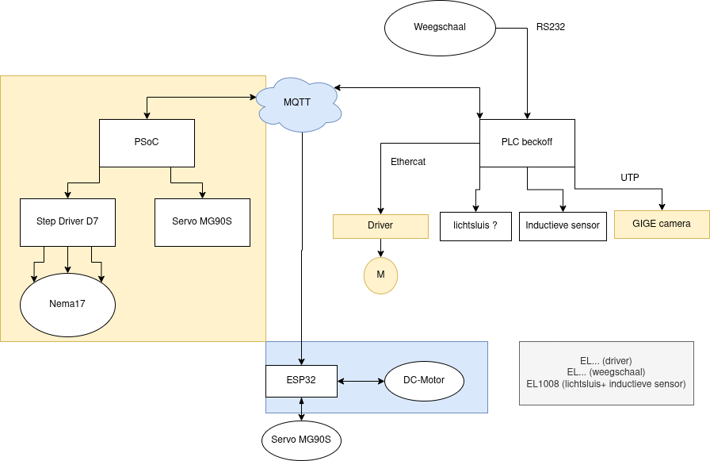

# Overzicht taken Project Pannekoek

## 1. MQTT
<b>Doel</b>: connectie van PSoC, ESP32 & PLC om automatisch delen van project te starten.
 <b>Status</b>: basis klaar voor integratie met andere delen

## 2. ESP32 Mixer
<b>Doel</b>: DC-motor mixer besturen + communicatie MQTT testen
 <b>Status</b>: basis klaar voor integratie met andere delen

## 3. PSoC06
<b>Doel</b>: Robotarm (NEMA17,servo) besturen om ingredienten in een box op te nemen en in de Mixer te plaatsen.
 <b>Status</b>: besturen motors lukt, nu nog potitionering voor oppakken transportband/ afleveren mixer.

## 4. Beckoff PLC

<b>Doel</b>: Bediening Weegschaal,Inductieve sensor, GIGE camera, DC Motor (transportband)
 <b>Status</b>: bezig met GIGE camera

## Progressie tussenperiode 1 (23/03/2026)

